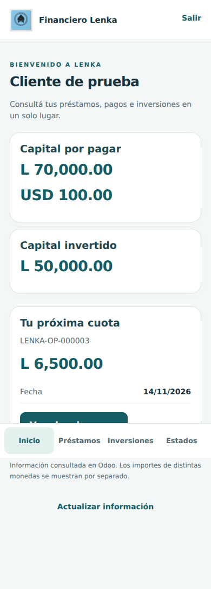

# Financiero Lenka móvil — primera versión

Aplicación web adaptable a Android y iPhone, alojada en el mismo Odoo. No requiere
un segundo servidor ni copiar la cartera a otra base. No es todavía un APK ni una
publicación en App Store / Google Play.

## Acceso

1. Actualizar `lenka_financiero` a `18.0.1.0.10` primero en pruebas.
2. La gerencia habilita al cliente desde Contactos → Financiero Lenka →
   Habilitar acceso App Lenka. No habilitar usuarios reales como parte del despliegue.
3. El cliente debe disponer de credenciales de Odoo/portal. El botón existente no
   envía una invitación de contraseña: gestionar esa invitación por el flujo normal de Odoo.
4. Abrir `https://grupomegatk.odoo.com/lenka/app` e iniciar sesión en Odoo.
5. En el teléfono, usar Añadir a pantalla de inicio cuando el navegador lo permita.

## Incluido

- Resumen de capital pendiente e invertido, separado por moneda.
- Préstamos, próxima cuota, plan, capital/intereses/mora y pagos aplicados.
- Inversiones, intereses registrados y retiros aplicados.
- Resúmenes de estados de cuenta ya generados/enviados.
- Sesión vencida, sin conexión, sin registros, errores y actualización manual.
- La interfaz no contiene acciones para aprobar préstamos, desembolsar, registrar
  cobros ni retirar inversiones. La información se obtiene de las rutas JSON-RPC
  existentes `/lenka/mobile/v1/…` con la sesión del mismo origen.

## Seguridad y límites

Las consultas verifican grupo móvil y habilitación, contacto y empresas asignadas
al usuario. Los detalles excluyen solicitudes no aprobadas. Los clientes no pueden
habilitar accesos mediante las acciones públicas del modelo. No se altera el flujo
de autorización exclusiva de Luis Morán.

No se almacenan tokens, saldos ni expedientes en localStorage/IndexedDB, no hay
service worker y las respuestas financieras llevan `Cache-Control: no-store`.
La aplicación requiere conexión; no autoriza operaciones sin conexión.
Los estados de cuenta se muestran como resumen; la descarga PDF queda para una
ampliación con autorización por documento.

## Comprobaciones

Frontend: `TZ=America/Tegucigalpa node --test lenka_financiero/static/tests/mobile/core.test.mjs`

Pantallas con datos ficticios: instalar Playwright y Chromium en el entorno de
desarrollo y ejecutar desde la raíz del repositorio:
`node lenka_financiero/static/tests/mobile/ui.test.cjs`. No consulta Odoo real.

Odoo: ejecutar la clase `TestLenkaMobileService` en una base de pruebas con
`--test-tags /lenka_financiero:TestLenkaMobileService`. Verificar también las
pruebas existentes antes de desplegar y el flujo de acceso real en portal.

La vista móvil usa un manifiesto web y el icono existente de Lenka. Los colores
son provisionales; no se modificó el logo. No hay autoalta ni permisos concedidos
a clientes durante la instalación.

## Vista de referencia

Datos ficticios utilizados en la prueba de interfaz; no representan una cuenta real.

Validación local: 7 pruebas de core aprobadas; pantallas probadas en 360, 390,
768 y 1280 px, navegación y errores. La ejecución de las pruebas Odoo y la
validación de sesión portal en servidor están pendientes de acceso al entorno.
